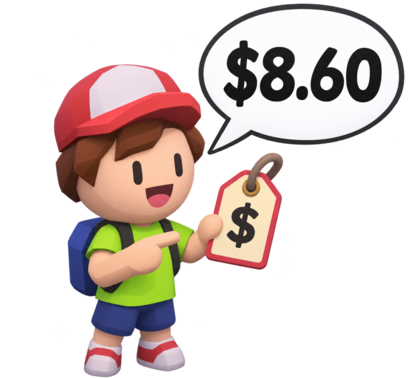
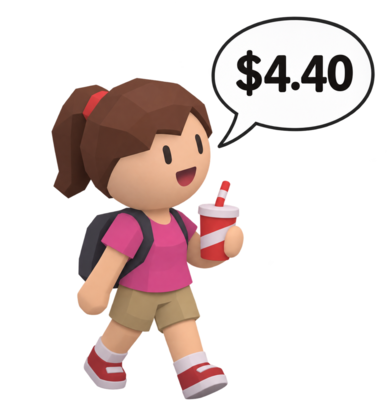
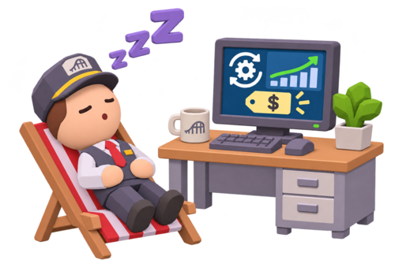
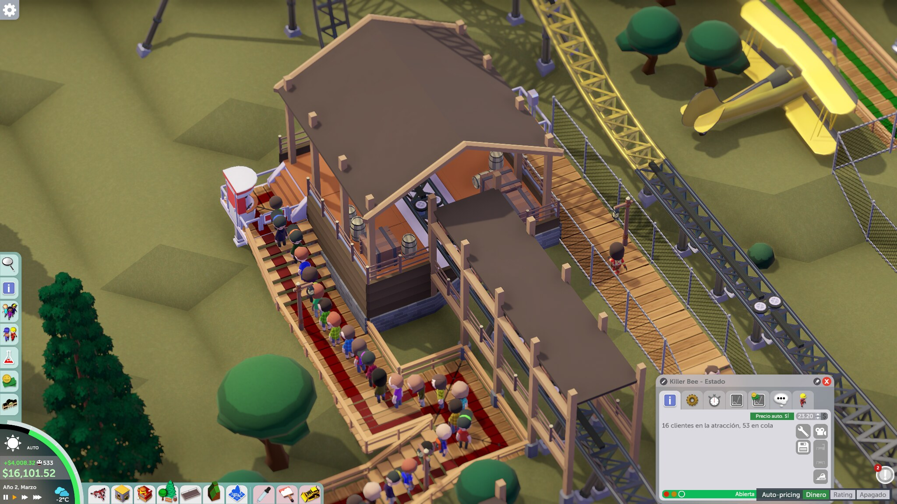
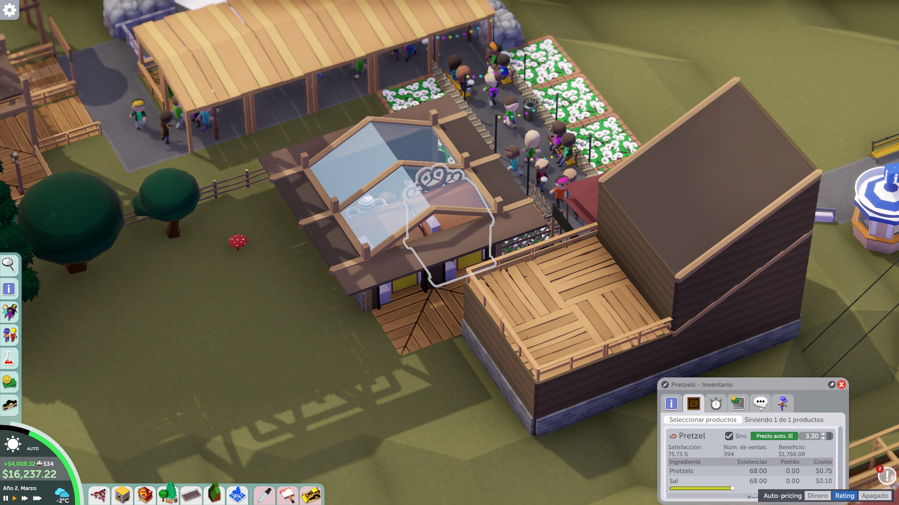
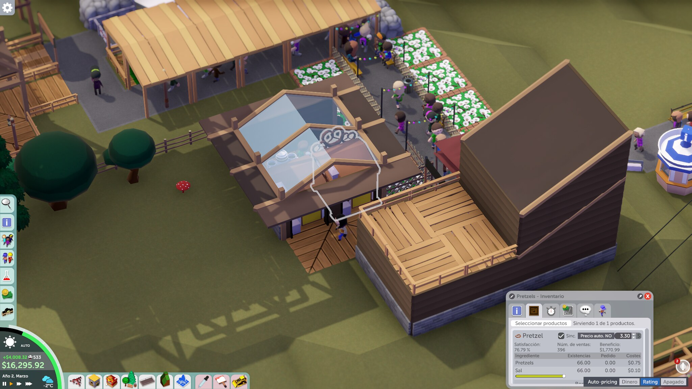
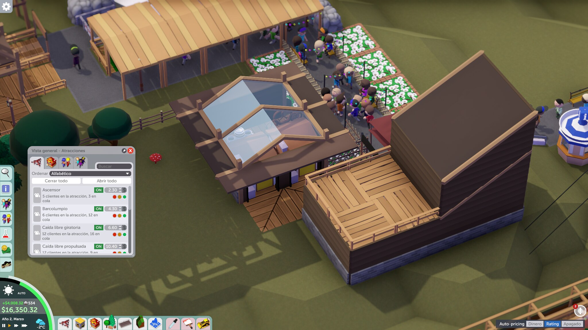

# Auto Pricing para Parkitect

El mod ajusta automáticamente los precios de las atracciones y los productos según la valoración de los visitantes, y te deja elegir en cualquier momento si todo el parque prioriza el **dinero** o el **rating**. Usa español cuando Parkitect está en español e inglés para los demás idiomas. [English](README.md).

## Un día en el parque

**Visitante de una atracción:** «¿$8.60?» El mod estima el precio de entrada según los visitantes interesados en esa atracción.

**Visitante de una tienda:** «¿$4.40?» También puede estimar precios de productos si está activada esa opción.

**Administrador:** «Hora de descansar». Auto Pricing revisa los precios con el intervalo elegido; puedes pasar cualquier precio individual a control manual.

El diálogo y los precios son ilustrativos: no son precios fijos ni una conversación dentro del juego. Consulta los detalles y límites más abajo.

## Dinero o Rating

Un panel llamado **Auto-pricing** aparece abajo a la derecha de la pantalla. Puedes arrastrarlo a donde quieras; el juego recuerda dónde lo dejas. Elige qué priorizan los precios automáticos en **todo el parque**:

| Opción | Qué hace |
| --- | --- |
| **Dinero** (por defecto) | Prioriza ganar dinero. Los precios buscan cerca de 1,25 veces lo que el visitante típico interesado cree que vale cada atracción o producto (se ajusta en los ajustes del mod). A los visitantes el parque les puede parecer caro, así que la nota de precio queda cerca del 50 % y la nota del parque baja. |
| **Rating** | Prioriza la nota del parque sobre el dinero. Los precios empiezan cerca de 0,75 veces la valoración del visitante para mejorar su experiencia, así que ganas menos. Si el escenario tiene una meta de nota que aún no cumples, los precios siguen bajando, hasta 0,5 veces, hasta lograrla, y vuelven a subir cuando sobra margen. |
| **Apagado** | Apaga los precios automáticos en todo el parque. Todos los precios los pones tú. |

Puedes cambiar cuando quieras, incluso dentro de la misma partida: Dinero mientras juntas efectivo y Rating para llegar a la meta de nota de un escenario, o al revés. Pasa el ratón sobre cada opción para ver una explicación corta (en español o inglés, según el idioma del juego). Si un escenario pide una nota que aún no tienes y estás en Dinero, el panel se pone ámbar y su texto te dice qué meta falta; nunca cambia de modo por su cuenta.

El modo Rating reacciona a las metas del escenario sobre la nota general del parque, la nota de precios, la de experiencias y la de felicidad. No reacciona a metas de dinero. Las notas del parque son promedios móviles de los visitantes que se van, así que un cambio de precios tarda varios minutos de juego en notarse.

En un parque de prueba (45 minutos de juego por prueba, una prueba por nivel, así que los números son orientativos), bajar el nivel de precio de 1,25 a 0,75 subió la nota del parque de 80 % a 85 % y la nota de precios de 47 % a 65 %, pero los ingresos cayeron cerca de un 60 %. Con 0,5 la nota del parque llegó a 89 %, con casi ninguna ganancia.

## Instalación y uso

[Suscríbete en Steam Workshop](https://steamcommunity.com/sharedfiles/filedetails/?id=3832850553) y activa **Auto Pricing** en los ajustes de mods del juego. Como alternativa, descarga la [versión publicada](https://github.com/weedoozas/parkitect-auto-pricing/releases/latest) y copia `AutoPrecios.dll` a una carpeta propia dentro de `Mods` y actívalo. En los ajustes puedes elegir atracciones y tiendas, el nivel de precio que usa el modo Dinero, porcentaje máximo deseado de visitantes interesados que no pagarían e intervalo de ajuste.

Usa el panel **Auto-pricing** de abajo a la derecha para elegir Dinero, Rating o Apagado en todo el parque. Pulsa **Precio auto. SÍ** junto al precio de una atracción o producto para fijar solo ese precio a mano; vuelve a pulsarlo para automatizarlo (en la lista de atracciones solo dice ON u OFF). El texto de ayuda muestra el precio sugerido y una estimación de rechazos. Los productos con precio sincronizado comparten el interruptor. Con el panel en Apagado, los interruptores quedan grises y puedes editar cualquier precio.

El ajuste automático está activado por defecto, en modo Dinero. Los ajustes generales y la posición del panel quedan en las preferencias del juego; el modo y los interruptores individuales se guardan por parque en la carpeta de datos persistentes del juego, dentro de `AutoPricing` (`modo-<parque>.txt` y `estado-<parque>.txt`). Desactivar el mod no restaura los precios anteriores; puedes guardar una copia antes de probarlo.

## Cambios

- **1.3.0:** nuevo panel **Dinero / Rating / Apagado** para todo el parque, movible y recordado por partida; el modo Rating sigue las metas de nota del escenario; el interruptor junto a cada precio ahora solo afecta a ese precio; textos de ayuda sencillos en español e inglés; el nivel de precio baja hasta 0,50.
- **1.2.1:** si el mod está instalado dos veces (Workshop y carpeta Mods) solo actúa una copia; capturas renovadas.
- **1.2.0:** primera versión pública.

## Capturas

Ventana de una atracción: el interruptor verde hace automático el precio de esa atracción, y el panel **Auto-pricing** de abajo a la derecha elige Dinero, Rating o Apagado para todo el parque:

Los productos de las tiendas tienen el mismo interruptor (aquí con el parque en modo Rating):

En la lista de atracciones el interruptor solo dice ON u OFF:

Las capturas son del juego; la portada fue creada con IA.

## Cálculo y límites

Por defecto calcula cada 20 segundos reales. Usa la mediana del valor de los visitantes interesados multiplicada por el nivel de precio (el de los ajustes en Dinero, 0,75 o menos en Rating) y un límite basado en un percentil inferior; redondea a 0,10 y suaviza cambios pequeños. Si hay menos de cinco muestras, estima atracciones por su emoción y deja sin cambiar los productos. Respeta los escenarios con atracciones o productos gratis. El coste mínimo de un producto puede superar el límite estimado, por lo que el porcentaje de rechazo es orientativo. Puede moderar precios de atracciones cuando se cobra entrada. No se ha comprobado la compatibilidad con otros mods que modifiquen precios ni con multijugador.

Los informes opcionales `informe.txt` e `historial.csv` quedan en `AutoPricing` y no se envían a ningún servidor. Para compilar (incluida la configuración `Beta`, que genera «Auto Pricing BETA» con otro identificador para probar sin tocar la versión publicada), reportar errores o contribuir consulta el [README en inglés](README.md). El código se ofrece bajo la licencia permisiva [0BSD](LICENSE); Parkitect y sus recursos pertenecen a sus respectivos titulares. Este es un mod no oficial.
