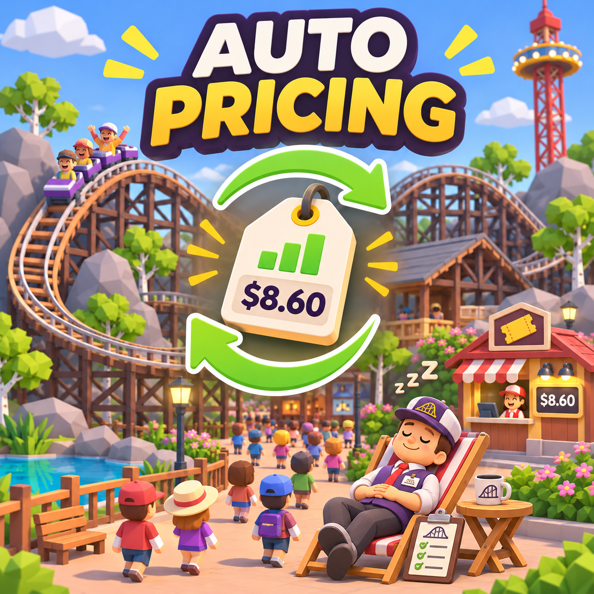
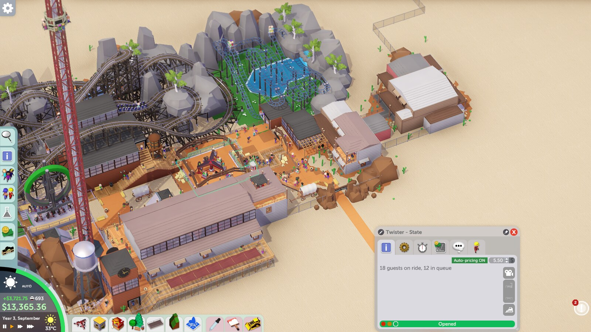
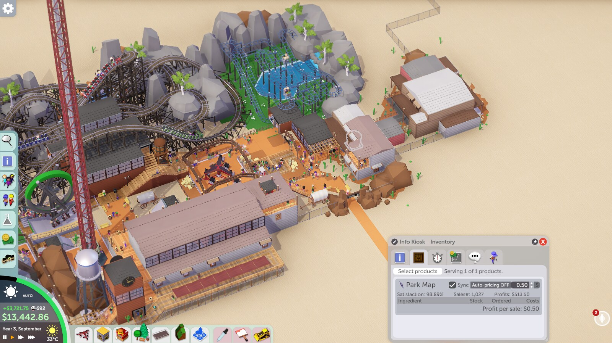

# Auto Pricing for Parkitect



Auto Pricing adjusts ride admission and shop product prices based on what your current guests value. Set it once and keep building your park. English is the default; the mod switches to Spanish when Parkitect's language is Spanish. [Leer en español](README.es.md).

## Install and use

1. Subscribe on Steam Workshop, then enable **Auto Pricing** in Parkitect's mod settings. Restart the game if prompted. Alternatively, copy `AutoPrecios.dll` into its own folder under the game's `Mods` directory and enable it there.
2. Open the mod's settings to choose whether it controls rides, shops, or both, the price level, the target maximum share of interested guests priced out, and how often to adjust prices.
3. Next to a ride or product price, click **Auto-pricing ON** to take manual control; click it again to resume automatic pricing. Hover for the suggested price and estimated share of interested guests who would refuse the current price. Synchronized product prices share the same switch.

Automatic pricing is on by default. Global settings persist in the game's preferences; individual switches are saved per park in the game's persistent data directory, under `AutoPricing`. The mod changes prices in the park, so consider making a separate save before trying it. Disabling the mod does not restore earlier prices.

## Screenshots

The green switch enables automatic pricing on a ride:



The grey switch leaves the selected shop product under manual control:



Screenshots are from the game; the cover illustration is AI-generated.

## How it works

Every 20 real seconds by default, the mod samples interested guests and estimates their valuation. Its target is based on the median valuation, capped using a lower percentile and the configured rejection target. It rounds to $0.10 and smooths small changes. For rides with fewer than five samples, it estimates a price from excitement; for products it leaves the price alone until there are at least five samples. The mod respects scenarios that require free rides or products.

When enabled, the cost floor can override the estimated product cap, so the rejection target is a guideline, not a guarantee. Ride prices can also be moderated when park admission is charged. Defaults and the adjustment interval can be changed in mod settings. This is an estimate, not a promise of maximum profit or perfect guest satisfaction. Compatibility with other mods that modify the same prices has not been established. Multiplayer has not been tested.

Optional reports (`informe.txt` and `historial.csv`) are written to the `AutoPricing` data folder. Settings and reports are local and are not sent to the developer.

## Build from source

Requires the .NET SDK and a local Parkitect installation. Game assemblies are not redistributed. On Linux with the default Steam path:

```sh
dotnet build -c Release
```

For a different installation, pass the path containing `Parkitect.dll` and Unity's managed DLLs:

```sh
dotnet build -c Release -p:GameManaged="/path/to/Parkitect_Data/Managed"
```

The output is `bin/Release/AutoPrecios.dll`. To also install locally, pass `-p:InstallMod=true` and, if needed, `-p:ModFolder="/path/to/Parkitect/Mods/AutoPrecios"`. Do not commit or redistribute the game's assemblies.

## Bugs and contributions

[Open an issue](https://github.com/weedoozas/parkitect-auto-pricing/issues/new/choose) for bugs or suggestions. Include your OS, Parkitect version, mod version, steps to reproduce, expected and actual behavior, and relevant logs or screenshots. Please remove personal information before sharing files. Pull requests and forks are welcome.

The source code is available under the [0BSD license](LICENSE): use, copy, modify and redistribute it for any purpose. Parkitect and its assets belong to their respective owners. This is an unofficial community mod.
