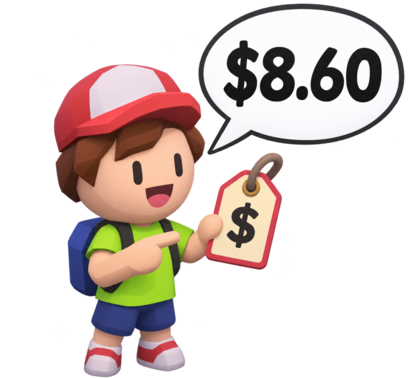
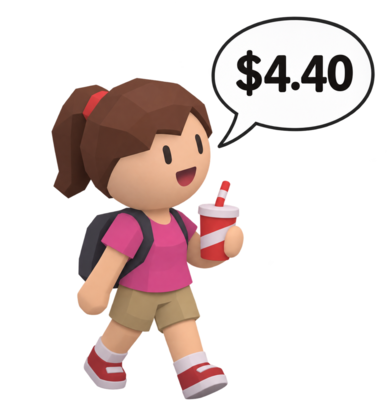
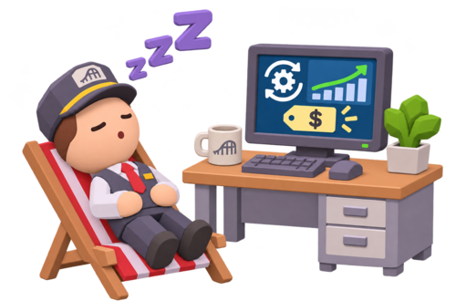
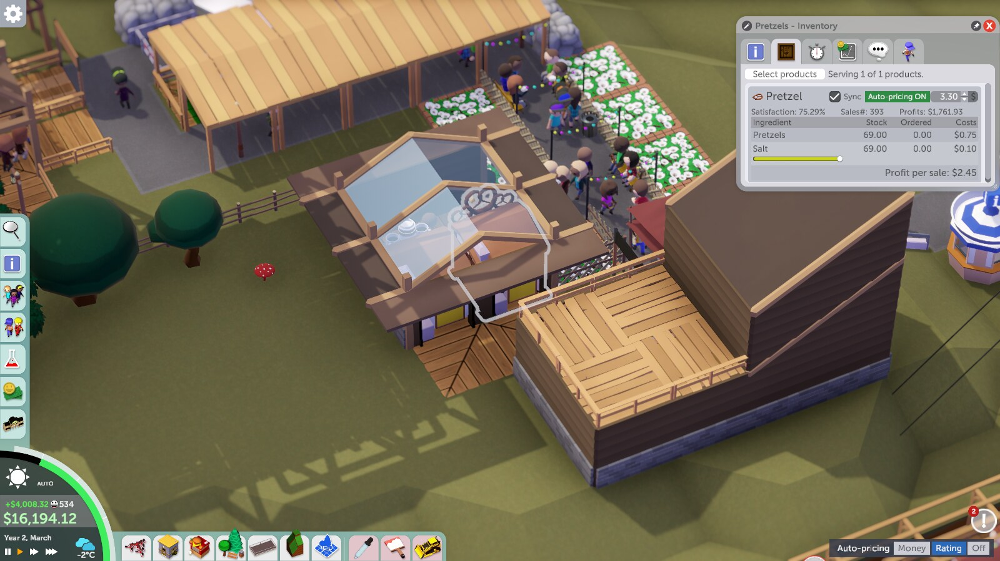
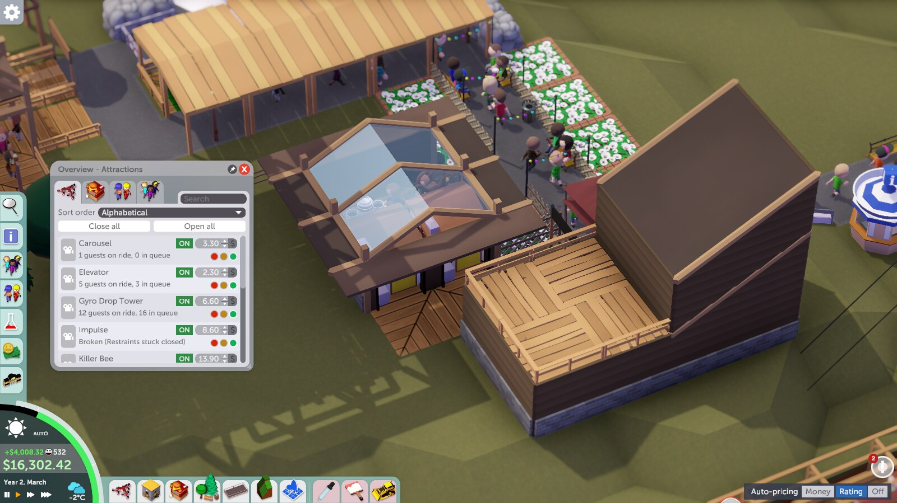

# Auto Pricing for Parkitect


Auto Pricing adjusts ride admission and shop product prices based on what your current guests value. Set it once and keep building your park, and switch the whole park between prioritizing **money** and prioritizing the park **rating** whenever you want. English is the default; the mod switches to Spanish when Parkitect's language is Spanish. [Leer en español](README.es.md).

## A day at the park

**Ride guest:** “$8.60?” The mod estimates a ride's admission price from the guests interested in it.



**Shop guest:** “$4.40?” It can estimate shop product prices too, when shop pricing is enabled.



**Park manager:** “Time to relax.” Auto Pricing reviews the prices at the selected interval; you can still switch individual prices to manual.



The dialogue and prices are illustrative, not fixed prices or an in-game conversation. See the details and limitations below.

## Money or Rating

A panel labelled **Auto-pricing** sits at the bottom right of the screen. Drag it anywhere; the game remembers where you leave it. It chooses what automatic prices prioritize in the **whole park**:

| Option | What it does |
| --- | --- |
| **Money** (default) | Prioritizes earning money. Prices aim for about 1.25 times what the typical interested guest thinks each ride or product is worth (adjustable in the mod settings). Guests may find the park expensive, so the price rating stays near 50% and the park rating is lower. |
| **Rating** | Prioritizes the park rating over income. Prices start at about 0.75 times the guest's valuation to improve their experience, so you earn less. If the scenario has a rating goal you have not reached, prices keep dropping, down to 0.5 times, until the goal is met, and rise again when there is spare margin. |
| **Off** | Turns off automatic prices in the whole park. Every price is yours. |

You can switch at any time, even within the same game: Money while you build up cash and Rating to reach a scenario's rating goal, or the other way around. Hover over each option for a short explanation (English or Spanish, following the game language). If a scenario asks for a rating you have not reached while you are in Money, the panel turns amber and its tooltip says which goal is missing; it never changes mode by itself.

Rating mode reacts to scenario goals for the overall park rating, the price rating, the experiences rating and the happiness rating. It does not react to money goals. Park ratings are running averages of guests leaving the park, so a change in prices takes several minutes of game time to show.

In one test park (45 minutes of game time per run, one run per level, so treat the numbers as indicative), lowering the price level from 1.25 to 0.75 raised the park rating from 80% to 85% and the price rating from 47% to 65%, but income fell by roughly 60%. At 0.5 the park rating reached 89%, with almost no profit.

## Install and use

1. [Subscribe on Steam Workshop](https://steamcommunity.com/sharedfiles/filedetails/?id=3832850553), then enable **Auto Pricing** in Parkitect's mod settings. Restart the game if prompted. Alternatively, download the [release](https://github.com/weedoozas/parkitect-auto-pricing/releases/latest) and copy `AutoPrecios.dll` into its own folder under the game's `Mods` directory and enable it there.
2. Open the mod's settings to choose whether it controls rides, shops, or both, the price level used by Money mode, the target maximum share of interested guests priced out, and how often to adjust prices.
3. Use the **Auto-pricing** panel at the bottom right to pick Money, Rating or Off for the whole park.
4. Next to a ride or product price, click **Auto-pricing ON** to take manual control of that price only; click it again to resume automatic pricing. (In the ride list it reads just ON or OFF.) Hover for the suggested price and the estimated share of interested guests who would refuse the current price. Synchronized product prices share the same switch. With the panel set to Off, the switches are grey and every price can be edited.

Automatic pricing is on by default, in Money mode. Global settings and the panel position persist in the game's preferences; the mode and the individual switches are saved per park in the game's persistent data directory, under `AutoPricing` (`modo-<park>.txt` and `estado-<park>.txt`). The mod changes prices in the park, so consider making a separate save before trying it. Disabling the mod does not restore earlier prices.

## Screenshots

Ride window: the green switch makes this ride's price automatic, and the **Auto-pricing** panel at the bottom right chooses Money, Rating or Off for the whole park:


Shop products get the same switch; drinks and food are priced automatically too (here with the park in Rating mode):



The grey switch leaves the selected shop product under manual control:


In the ride list the switch reads just ON or OFF:



Screenshots are from the game; the cover illustration is AI-generated.

## How it works

Every 20 real seconds by default, the mod samples interested guests and estimates their valuation. Its target is the median valuation times the price level (the level chosen in the settings for Money, 0.75 or lower for Rating), capped using a lower percentile and the configured rejection target. It rounds to $0.10 and smooths small changes. For rides with fewer than five samples, it estimates a price from excitement; for products it leaves the price alone until there are at least five samples. The mod respects scenarios that require free rides or products.

When enabled, the cost floor can override the estimated product cap, so the rejection target is a guideline, not a guarantee. Ride prices can also be moderated when park admission is charged. Defaults and the adjustment interval can be changed in mod settings. This is an estimate, not a promise of maximum profit or perfect guest satisfaction. Compatibility with other mods that modify the same prices has not been established. Multiplayer has not been tested.

Optional reports (`informe.txt` and `historial.csv`) are written to the `AutoPricing` data folder. Settings and reports are local and are not sent to the developer.

## Changes

- **1.3.0:** new park-wide **Money / Rating / Off** panel, movable and remembered per game; Rating mode follows the scenario's rating goals; the switch next to each price now only affects that price; plain-language tooltips in English and Spanish; the price level slider goes down to 0.50.
- **1.2.1:** only one copy acts if the mod is installed twice (Workshop and Mods folder); refreshed screenshots.
- **1.2.0:** first public release.

## Build from source

Requires the .NET SDK and a local Parkitect installation. Game assemblies are not redistributed. On Linux with the default Steam path:

```sh
dotnet build -c Release
```

For a different installation, pass the path containing `Parkitect.dll` and Unity's managed DLLs:

```sh
dotnet build -c Release -p:GameManaged="/path/to/Parkitect_Data/Managed"
```

The output is `bin/Release/AutoPrecios.dll`. To also install locally, pass `-p:InstallMod=true` and, if needed, `-p:ModFolder="/path/to/Parkitect/Mods/AutoPrecios"`. Do not commit or redistribute the game's assemblies.

To try changes without touching a published copy, build the `Beta` configuration (`dotnet build -c Beta -p:InstallMod=true`). It produces **Auto Pricing BETA** with its own assembly name and identifier, installed to `Mods/AutoPrecios-beta`, so it can sit beside the Workshop version. Enable only one of them at a time, because they do not know about each other and would both change prices.

For development there is also a test mode: if a `prueba.txt` file sits next to the DLL, the mod opens a saved park by itself at startup, speeds up time, writes `informe.txt`/`historial.csv`, can take in-game screenshots and closes the game. Its keys, one per line, are `partida=<file>`, `velocidad=`, `segundos=`, `ventanas=1`, `tienda=<text>`, `nivel=`, `modo=money|rating|off`, `meta=<rating>` and `ajustar=0`. It is meant for contributors, not for normal play.

## Bugs and contributions

[Open an issue](https://github.com/weedoozas/parkitect-auto-pricing/issues/new/choose) for bugs or suggestions. Include your OS, Parkitect version, mod version, steps to reproduce, expected and actual behavior, and relevant logs or screenshots. Please remove personal information before sharing files. Pull requests and forks are welcome.

The source code is available under the [0BSD license](LICENSE): use, copy, modify and redistribute it for any purpose. Parkitect and its assets belong to their respective owners. This is an unofficial community mod.
